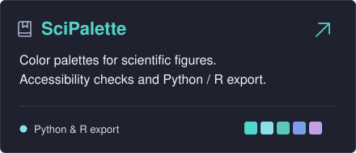
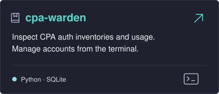
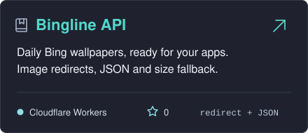
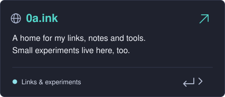
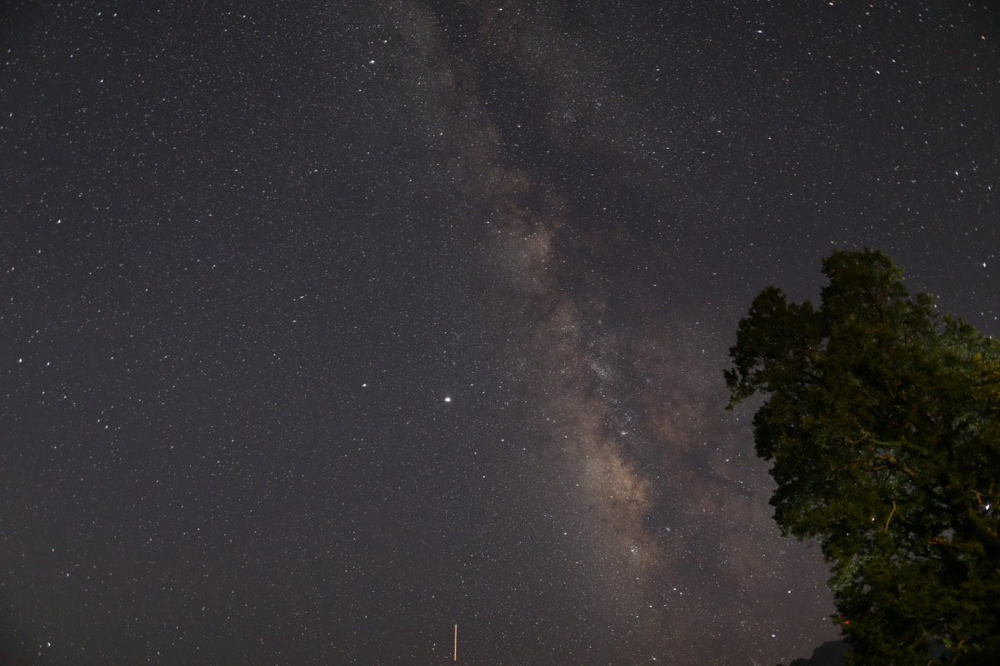
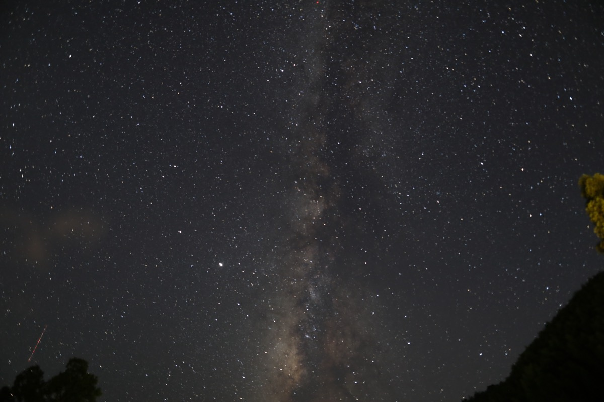
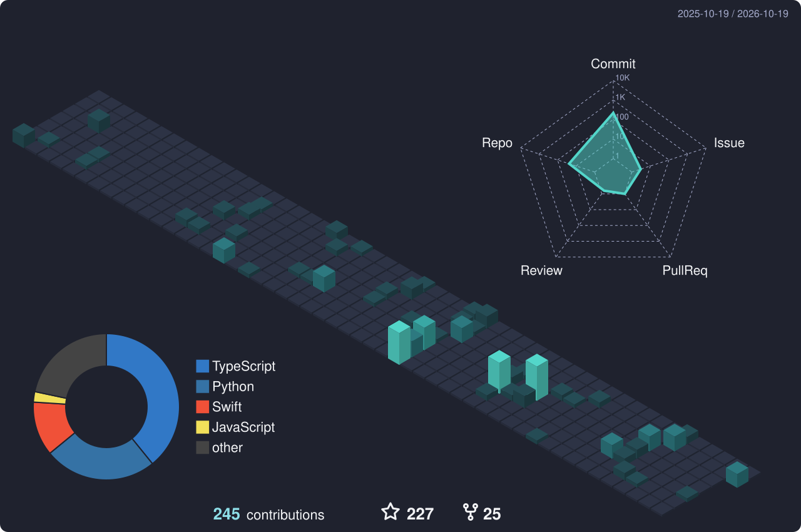

  <picture>
    <source media="(prefers-color-scheme: dark)" srcset="assets/banner-dark.svg">
    
  </picture>

  I'm studying Biomedical Informatics at the <b>ZJU-UoE Institute, Zhejiang University</b>. 
  I work with biological data, build web tools, and photograph the night sky.

  
  
  
  

<h2>Projects</h2>

  
  
  
  

[All repositories](https://github.com/fantasticjoe?tab=repositories) · [Try SciPalette](https://scipalette.fantasticjoe.com) · [Bingline API](https://wall.0a.ink/api/latest)

<h2>Tools I use</h2>

  
  
  
  
  
  

<h2>Photography</h2>

My lunar eclipse sequence was featured in [NASA's Astronomy Picture of the Day](https://apod.nasa.gov/apod/ap250912.html) on September 12, 2025, alongside Lucy Yunxi Hu's view from Australia.

  
  

[More photographs](https://www.fantasticjoe.com/gallery/)

<h2>GitHub activity</h2>

<picture>
  <source media="(prefers-color-scheme: dark)" srcset="metrics-languages-dark.svg">
  
</picture>

<h2>Writing</h2>

A few posts from my blog, in Chinese:

- [SciPalette: Choosing colors for scientific figures](https://blog.fantasticjoe.com/9d4f0b28.html)
- [Bingline: A small API for the daily Bing wallpaper](https://blog.fantasticjoe.com/46894891.html)
- [Hortus: Moving my blog to a new theme](https://blog.fantasticjoe.com/75d3a91c.html)
- [A prompt for structured literature reviews](https://blog.fantasticjoe.com/fc133c35.html)

<!-- Visual reference: https://github.com/DenverCoder1. Assets are authored for this profile. -->
